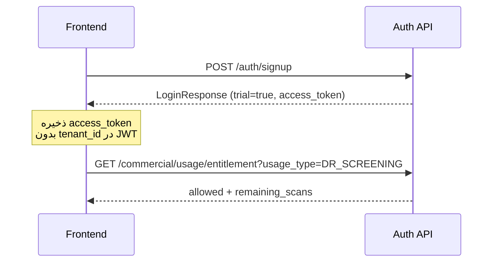
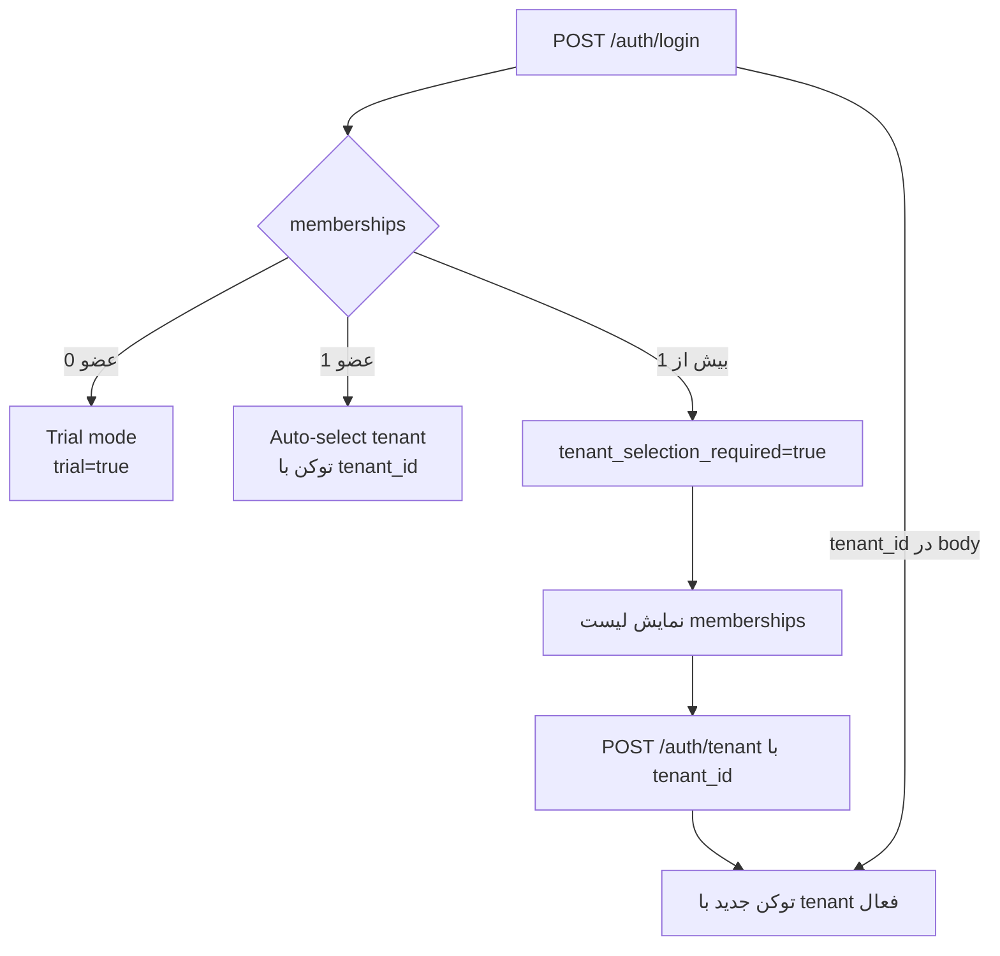
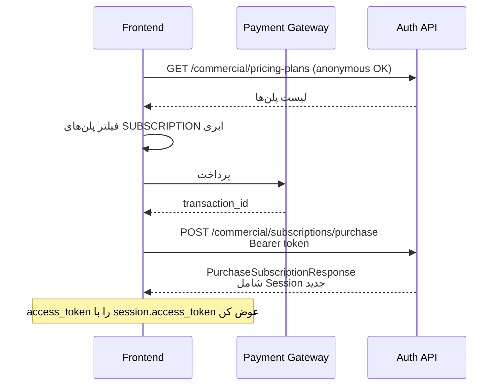

# EyeMind Auth API — راهنمای فرانت‌اند

داکیومنت مرجع برای پیاده‌سازی فلوهای احراز هویت، عضویت در سازمان (Tenant)، Trial و سرویس‌های تجاری.

**Base URL (Development):** `http://localhost:5237`  
**API Version:** `v1`  
**Prefix:** `/api/v1/...`  
**Swagger:** `/swagger`

---

## ۱. قراردادهای مشترک

### ۱.۱ فرمت JSON

همه request/responseها با **snake_case** هستند (`JsonNamingPolicy.SnakeCaseLower`).

```json
{
  "first_name": "علی",
  "phone_number": "0912..."
}
```

Enumها به صورت **string** ارسال/دریافت می‌شوند (مثلاً `"TENANT_ADMIN"`، نه عدد).

### ۱.۲ Envelope موفقیت

```json
{
  "data": { }
}
```

برای لیست‌های صفحه‌بندی‌شده، `data` خودش شامل صفحه‌بندی است:

```json
{
  "data": {
    "total_rows": 42,
    "page_number": 1,
    "total_pages": 2,
    "data": [ ]
  }
}
```

### ۱.۳ Envelope خطا

```json
{
  "error_code": "AUTH-00001",
  "error_message": "نام کاربری یا رمز عبور اشتباه است.",
  "retryable": false,
  "error_details": null
}
```

### ۱.۴ احراز هویت

| مورد | مقدار |
|------|--------|
| Header | `Authorization: Bearer <access_token>` |
| Claim سازمان فعال | `tenant_id` (Guid) |
| Claim نقش | `role` / `http://schemas.microsoft.com/ws/2008/06/identity/claims/role` |
| عمر توکن | پیش‌فرض **۱۸۰ دقیقه** (`Jwt:AccessTokenMinutes`) |

توکن بدون `tenant_id` یعنی کاربر در حالت **Trial** است یا باید سازمان را انتخاب کند.

### ۱.۵ نقش‌ها (`Role`)

| مقدار | عنوان فارسی | توضیح |
|--------|-------------|--------|
| `SUPER_ADMIN` | سوپر ادمین | ادمین پلتفرم |
| `TENANT_ADMIN` | ادمین بیمارستان | ادمین یک سازمان |
| `DOCTOR` | دکتر | کاربر بالینی |
| `OPERATOR` | اپراتور | اپراتور غربالگری |

### ۱.۶ Rate limiting

مسیرهای Auth (`/api/v1/auth/*`) و validate آن‌پرمیس تحت policy با نام `auth` محدود شده‌اند. در صورت زیاد بودن درخواست، احتمال دریافت `429` وجود دارد.

---

## ۲. فلوهای اصلی فرانت‌اند

### ۲.۱ Signup (ثبت‌نام عمومی → Trial)

کاربر بدون دعوت‌نامه ثبت‌نام می‌کند، بلافاصله لاگین می‌شود و تا **۱۰۰ اسکن رایگان** Trial دارد.



**قوانین UI:**

- بعد از signup موفق، `data.trial === true` و `data.trial_remaining_scans` (حداکثر ۱۰۰) را نشان بده.
- `active_tenant_id` و `active_role` معمولاً `null` هستند.
- کاربر می‌تواند غربالگری Trial انجام دهد یا اشتراک بخرد و سازمان بسازد.

---

### ۲.۲ Login + انتخاب سازمان



**حالت‌های `LoginResponse`:**

| شرط | فیلدهای کلیدی | اقدام فرانت |
|------|----------------|-------------|
| بدون عضویت | `trial: true`, `tenant_selection_required: false` | ورود به Trial |
| یک عضویت | `active_tenant_id` پر، `trial: false` | ورود مستقیم به داشبورد سازمان |
| چند عضویت | `tenant_selection_required: true`, `access_token` بدون tenant | صفحه انتخاب سازمان → `POST /auth/tenant` |
| لاگین با `tenant_id` | اگر عضو نباشد → خطا | فقط tenantهای لیست‌شده مجازند |

**نکته:** در حالت Selection Required هم توکن صادر می‌شود، ولی بدون `tenant_id`. تا قبل از switch، endpointهایی که به tenant نیاز دارند کار نمی‌کنند.

---

### ۲.۳ خرید اشتراک آنلاین (Checkout)

فقط برای پلن‌های **اشتراک ابری** (`ProductType=SUBSCRIPTION` + `BillingType` ماهانه/سالانه + لایسنس CLOUD).



**قوانین checkout:**

| وضعیت کاربر | `tenant_id` در body | نتیجه |
|-------------|---------------------|--------|
| بدون عضویت | `null` + اختیاری `tenant_name` | سازمان جدید ساخته می‌شود، کاربر `TENANT_ADMIN` می‌شود |
| دارای عضویت | باید ارسال شود | فقط اگر کاربر `TENANT_ADMIN` (یا SUPER_ADMIN) آن سازمان باشد |
| دارای عضویت | ارسال نشود | خطا: «برای خرید اشتراک، سازمان را انتخاب کنید.» |
| عضو غیر ادمین | tenant خودش | خطا: Forbidden |

بعد از خرید موفق:

1. `session.access_token` را جایگزین توکن قبلی کن.
2. اگر `tenant_created === true`، کاربر را به onboarding سازمان هدایت کن.
3. لایسنس و فاکتور در `license` / `invoice` / `payment` برمی‌گردد.

---

### ۲.۴ دعوت / افزودن عضو به سازمان

دو مسیر وجود دارد:

| مسیر | Endpoint | کاربرد |
|------|----------|--------|
| ساخت کاربر جدید داخل سازمان | `POST /auth/register` | کاربر هنوز حساب ندارد |
| افزودن کاربر موجود | `POST /tenants/members` | کاربر قبلاً signup/register شده |

**ماتریس نقش قابل اختصاص:**

| Caller | می‌تواند بسازد/اضافه کند |
|--------|---------------------------|
| `SUPER_ADMIN` | `TENANT_ADMIN`, `DOCTOR`, `OPERATOR` |
| `TENANT_ADMIN` | `DOCTOR`, `OPERATOR` |
| بقیه | هیچ |

`SUPER_ADMIN` را نمی‌توان از این APIها assign کرد.

---

### ۲.۵ غربالگری و Entitlement

قبل از شروع اسکن، entitlement را چک کن:

```
GET /api/v1/commercial/usage/entitlement?usage_type=DR_SCREENING
Authorization: Bearer ...
```

| حالت JWT | رفتار |
|----------|--------|
| بدون `tenant_id` + بدون عضویت | Trial (سقف ۱۰۰) |
| بدون `tenant_id` + دارای عضویت | خطا: ابتدا سازمان را انتخاب کنید |
| با `tenant_id` | بر اساس لایسنس فعال سازمان |

بعد از اسکن موفق در سرویس اصلی، مصرف را ثبت کن:

```
POST /api/v1/commercial/usage/screenings
{ "usage_type": "DR_SCREENING", "ai_screening_id": 123 }
```

`ai_screening_id` برای جلوگیری از ثبت تکراری است.

---

### ۲.۶ Switch سازمان در میانه جلسه

```
POST /api/v1/auth/tenant
Authorization: Bearer <current>
{ "tenant_id": "<guid>" }
```

پاسخ همان `LoginResponse` است؛ **حتماً توکن جدید را جایگزین کن**.

لیست عضویت‌ها بدون صدور توکن جدید:

```
GET /api/v1/auth/tenants
```

---

## ۳. Auth API

Base: `/api/v1/auth`  
Rate limit: `auth`

### ۳.۱ Signup — عمومی

`POST /api/v1/auth/signup`  
**Auth:** ندارد

**Request**

```json
{
  "first_name": "علی",
  "last_name": "محمدی",
  "phone_number": "09121234567",
  "email": "ali@example.com",
  "username": "ali.m",
  "password": "Aa1!aaaa"
}
```

**اعتبارسنجی پسورد:** حداقل ۸ کاراکتر، شامل حروف بزرگ، کوچک، عدد و نماد.

**Response `200`** → `LoginResponse` (معمولاً Trial)

**خطاهای رایج**

| Code | معنی |
|------|------|
| `AUTH-00003` | username یا email تکراری |
| `AUTH-00006` | اعتبارسنجی / خطای ثبت |

---

### ۳.۲ Login — عمومی

`POST /api/v1/auth/login`  
**Auth:** ندارد

**Request**

```json
{
  "username": "ali.m",
  "password": "Aa1!aaaa",
  "tenant_id": null
}
```

`tenant_id` اختیاری است؛ اگر کاربر چند سازمان دارد می‌تواند مستقیم همان را انتخاب کند.

**Response `200`** → `LoginResponse`

**خطاهای رایج**

| Code | HTTP | معنی |
|------|------|------|
| `AUTH-00001` | 401 | نام کاربری/رمز اشتباه |
| `AUTH-00002` | 401 | حساب قفل شده |
| `AUTH-00006` | 400 | عضویت در سازمان انتخابی فعال نیست |

---

### ۳.۳ Register — ساخت کاربر توسط ادمین

`POST /api/v1/auth/register`  
**Auth:** `SUPER_ADMIN` یا `TENANT_ADMIN`  
**نکته:** کاربر در **سازمان فعال JWT** (`tenant_id`) ساخته می‌شود.

**Request**

```json
{
  "first_name": "سارا",
  "last_name": "احمدی",
  "phone_number": "09120000000",
  "email": "sara@hospital.com",
  "role": "DOCTOR",
  "username": "sara.a",
  "password": "Aa1!aaaa"
}
```

**Response `200`**

```json
{
  "data": {
    "first_name": "سارا",
    "last_name": "احمدی",
    "phone_number": "09120000000",
    "email": "sara@hospital.com",
    "role": "DOCTOR",
    "role_title": "دکتر",
    "username": "sara.a",
    "tenant": {
      "name": "...",
      "code": "...",
      "contact_person": "...",
      "phone_number": "...",
      "email": "...",
      "address": "...",
      "status": "ACTIVE",
      "status_message": "فعال"
    }
  }
}
```

---

### ۳.۴ List my tenants

`GET /api/v1/auth/tenants`  
**Auth:** هر کاربر لاگین‌شده

**Response**

```json
{
  "data": [
    {
      "tenant_id": "3fa85f64-5717-4562-b3fc-2c963f66afa6",
      "tenant_name": "بیمارستان الف",
      "role": "DOCTOR",
      "role_title": "دکتر"
    }
  ]
}
```

---

### ۳.۵ Switch tenant

`POST /api/v1/auth/tenant`  
**Auth:** هر کاربر لاگین‌شده

**Request**

```json
{
  "tenant_id": "3fa85f64-5717-4562-b3fc-2c963f66afa6"
}
```

**Response:** `LoginResponse` با توکن جدید

---

### ۳.۶ مدل `LoginResponse`

```ts
type LoginResponse = {
  access_token: string;
  active_tenant_id: string | null;   // Guid
  active_role: Role | null;
  active_role_title: string | null;
  trial: boolean;
  trial_remaining_scans: number | null;
  tenant_selection_required: boolean;
  memberships: TenantMembershipResponse[];
};

type TenantMembershipResponse = {
  tenant_id: string;
  tenant_name: string;
  role: Role;
  role_title: string | null;
};
```

**الگوریتم پیشنهادی بعد از هر Login / Signup / Switch / Purchase:**

```ts
function handleSession(res: LoginResponse) {
  saveToken(res.access_token);

  if (res.tenant_selection_required) {
    navigate("/select-tenant", { memberships: res.memberships });
    return;
  }

  if (res.trial) {
    navigate("/trial", { remaining: res.trial_remaining_scans });
    return;
  }

  navigate("/app", {
    tenantId: res.active_tenant_id,
    role: res.active_role,
  });
}
```

---

## ۴. Tenants API

Base: `/api/v1/tenants`

### ۴.۱ Create tenant

`POST /api/v1/tenants`  
**Auth:** فقط `SUPER_ADMIN`

```json
{
  "name": "بیمارستان الف",
  "status": "ACTIVE",
  "code": "HOSP-001",
  "contact_person": "مدیر IT",
  "phone_number": "021...",
  "email": "it@hospital.com",
  "address": "تهران..."
}
```

> ساخت سازمان برای کاربر عادی معمولاً از مسیر **خرید اشتراک** انجام می‌شود، نه این endpoint.

### ۴.۲ Get tenant

`GET /api/v1/tenants/{tenantId}`  
**Auth:** `SUPER_ADMIN`

### ۴.۳ Add existing user as member

`POST /api/v1/tenants/members`  
**Auth:** `SUPER_ADMIN` یا `TENANT_ADMIN`

```json
{
  "tenant_id": null,
  "username": "ali.m",
  "role": "OPERATOR"
}
```

- اگر `tenant_id` خالی باشد، سازمان فعال JWT استفاده می‌شود.
- `SUPER_ADMIN` می‌تواند با ارسال `tenant_id` برای سازمان دیگر عضو اضافه کند.
- کاربر باید از قبل در سیستم وجود داشته باشد.

### ۴.۴ List users of active tenant

`GET /api/v1/tenants/users?page_number=1&page_size=25`  
**Auth:** `SUPER_ADMIN` یا `TENANT_ADMIN`  
بر اساس `tenant_id` داخل JWT فیلتر می‌شود.

---

## ۵. Commercial — مشترک

Base: `/api/v1/commercial`  
مگر خلافش گفته شده باشد، نیاز به Bearer دارد.

### ۵.۱ Pricing plans (کاتالوگ)

`GET /api/v1/commercial/pricing-plans`  
**Auth:** اختیاری (`AllowAnonymous`)

```ts
type PricingPlanResponse = {
  id: number;
  product_id: number;
  product_name: string;
  product_type: "SUBSCRIPTION" | "PAY_PER_USE" | "ENTERPRISE";
  metered_usage: UsageType | null;
  name: string;
  billing_type: "MONTHLY" | "YEARLY" | "PER_SCAN" | "ONE_TIME";
  price: number;
  included_scans: number | null;
  has_unlimited_usage: boolean;
  status: "ACTIVE" | "INACTIVE";
};
```

**فیلتر پیشنهادی UI برای خرید آنلاین:**

```ts
plans.filter(p =>
  p.status === "ACTIVE" &&
  p.product_type === "SUBSCRIPTION" &&
  (p.billing_type === "MONTHLY" || p.billing_type === "YEARLY")
);
```

### ۵.۲ List licenses

`GET /api/v1/commercial/licenses?tenant_id=<guid?>&model=<CommercialModel?>`  
**Auth:** لازم

`model` اختیاری: `PAY_PER_SCREENING` | `SUBSCRIPTION` | `ON_PREMISE` | `TRIAL`

### ۵.۳ Entitlement

`GET /api/v1/commercial/usage/entitlement?usage_type=DR_SCREENING`  
**Auth:** لازم  
Roles پیشنهادی برای اسکرین: هر کاربر لاگین‌شده (با قوانین Trial/Tenant بالا)

```ts
type ScreeningEntitlementResponse = {
  allowed: boolean;
  model: CommercialModel | null;
  license_id: number | null;
  license_end: string | null; // ISO datetime
  consumed_scans: number;
  remaining_scans: number | null;
  message: string | null;
};
```

اگر `allowed === false`، CTA مناسب:

- Trial تمام شده → صفحه خرید اشتراک
- `AUTH-00007` / لایسنس ندارید → خرید/تمدید
- `AUTH-00008` → سهمیه تمام شده
- `AUTH-00009` → نوع غربالگری پوشش داده نشده

### ۵.۴ Record screening usage

`POST /api/v1/commercial/usage/screenings`

```json
{
  "usage_type": "DR_SCREENING",
  "ai_screening_id": 987
}
```

`usage_type`های رایج: `DR_SCREENING`, `ROP_SCREENING` (همچنین `STORAGE`, `API_CALL` در دامنه تعریف شده‌اند).

### ۵.۵ Usage history

`GET /api/v1/commercial/usage?tenant_id=&page_number=1&page_size=25`  
**Auth:** `SUPER_ADMIN`, `TENANT_ADMIN`, `DOCTOR`, `OPERATOR`

### ۵.۶ Invoices

| Method | Path | Roles |
|--------|------|-------|
| GET | `/commercial/invoices?tenant_id=&page_number=&page_size=` | SUPER_ADMIN, TENANT_ADMIN |
| GET | `/commercial/invoices/{invoiceId}` | SUPER_ADMIN, TENANT_ADMIN |
| POST | `/commercial/invoices/{invoiceId}/payments` | SUPER_ADMIN, TENANT_ADMIN |
| POST | `/commercial/invoices/{invoiceId}/void` | SUPER_ADMIN |

**ثبت پرداخت**

```json
{
  "amount": 1500000,
  "transaction_id": "PG-UNIQUE-ID"
}
```

`transaction_id` باید یکتا باشد؛ تکرار → `AUTH-00012`.

---

## ۶. Subscriptions

Base: `/api/v1/commercial/subscriptions`

### ۶.۱ Purchase (مسیر اصلی فرانت کاربر)

`POST /api/v1/commercial/subscriptions/purchase`  
**Auth:** هر کاربر لاگین‌شده

```json
{
  "pricing_plan_id": 1,
  "tenant_id": null,
  "tenant_name": "کلینیک چشم من",
  "transaction_id": "ZP-2026-...."
}
```

**Response**

```ts
type PurchaseSubscriptionResponse = {
  tenant_id: string;
  tenant_name: string;
  tenant_created: boolean;
  role: Role;
  role_title: string | null;
  license: TenantLicenseResponse;
  invoice: InvoiceResponse;
  payment: PaymentResponse;
  session: LoginResponse; // ← توکن جدید
};
```

### ۶.۲ Assign (ادمین پلتفرم)

`POST /api/v1/commercial/subscriptions`  
**Auth:** `SUPER_ADMIN`

```json
{
  "tenant_id": "...",
  "pricing_plan_id": 1,
  "license_type": "CLOUD",
  "start_date": null
}
```

### ۶.۳ Current subscription

`GET /api/v1/commercial/subscriptions/current?tenant_id=`  
**Auth:** لازم

### ۶.۴ Renew

`POST /api/v1/commercial/subscriptions/{licenseId}/renew`  
**Auth:** `SUPER_ADMIN` یا `TENANT_ADMIN`

### ۶.۵ Create subscription invoice

`POST /api/v1/commercial/subscriptions/{licenseId}/invoices`  
**Auth:** `SUPER_ADMIN` یا `TENANT_ADMIN`

---

## ۷. Pay-per-screening

Base: `/api/v1/commercial/pay-per-screening`

| Method | Path | Roles |
|--------|------|-------|
| POST | `/licenses` | SUPER_ADMIN |
| POST | `/licenses/{licenseId}/renew` | SUPER_ADMIN, TENANT_ADMIN |
| POST | `/invoices` body: `{ "tenant_id": null }` | SUPER_ADMIN, TENANT_ADMIN |

Body assign مشابه subscription است (`tenant_id`, `pricing_plan_id`, `license_type`, `start_date`).

---

## ۸. On-premise

Base: `/api/v1/commercial/on-premise`

| Method | Path | Auth | توضیح |
|--------|------|------|--------|
| POST | `/licenses` | SUPER_ADMIN | تخصیص لایسنس |
| POST | `/licenses/{licenseId}/renew` | SUPER_ADMIN, TENANT_ADMIN | تمدید |
| POST | `/licenses/{licenseId}/invoices` | SUPER_ADMIN, TENANT_ADMIN | فاکتور |
| POST | `/deployments` | SUPER_ADMIN, TENANT_ADMIN | provision سرور |
| POST | `/deployments/{deploymentId}/rotate-key` | SUPER_ADMIN, TENANT_ADMIN | چرخش کلید |
| GET | `/deployments/current?tenant_id=` | Authenticated | وضعیت فعلی |
| POST | `/heartbeat` | Authenticated | heartbeat از سرور محلی |
| POST | `/validate` | Anonymous + rate limit | اعتبارسنجی کلید |

**Provision**

```json
{ "tenant_id": null, "server_ip": "10.0.0.12" }
```

**Heartbeat / Validate**

```json
{ "license_key": "...." }
```

پاسخ validate:

```ts
type OnPremiseValidationResponse = {
  valid: boolean;
  is_healthy: boolean;
  license_end: string | null;
  tenant_name: string | null;
  message: string | null;
};
```

> این بخش بیشتر برای پنل ادمین و agent سرور محلی است؛ در اپ کلینیک ابری معمولاً لازم نیست.

---

## ۹. مدل‌های پاسخ تجاری

```ts
type TenantLicenseResponse = {
  id: number;
  tenant_id: string;
  pricing_plan_id: number;
  plan_name: string;
  product_name: string;
  billing_type: BillingType;
  license_type: "CLOUD" | "ON_PREMISE" | "HYBRID";
  model: "PAY_PER_SCREENING" | "SUBSCRIPTION" | "ON_PREMISE" | "TRIAL";
  price: number;
  included_scans: number | null;
  has_unlimited_usage: boolean;
  start_date: string;
  end_date: string;
  status: "ACTIVE" | "INACTIVE";
};

type InvoiceResponse = {
  id: number;
  tenant_id: string;
  tenant_license_id: number | null;
  total_amount: number;
  status: "DRAFT" | "ISSUED" | "PAID" | "VOID";
  period_start: string | null;
  period_end: string | null;
  created_date: string;
  items: InvoiceItemResponse[];
};

type InvoiceItemResponse = {
  id: number;
  title: string;
  quantity: number;
  unit_price: number;
  total_price: number;
};

type PaymentResponse = {
  id: number;
  invoice_id: number;
  amount: number;
  transaction_id: string;
  status: "PENDING" | "SUCCEEDED" | "FAILED";
  paid_at: string;
  invoice_status: InvoiceStatus;
};

type ScreeningUsageResponse = {
  id: number;
  model: CommercialModel;
  usage_type: UsageType;
  ai_screening_id: number | null;
  count: number;
  unit_price: number;
  total_price: number;
  billable: boolean;
  consumed_scans: number;
  remaining_scans: number | null;
};
```

---

## ۱۰. کدهای خطا

| Code | HTTP | پیام پیش‌فرض | سناریوی فرانت |
|------|------|--------------|----------------|
| `AUTH-00001` | 401 | نام کاربری یا رمز عبور اشتباه است. | فرم لاگین |
| `AUTH-00002` | 401 | حساب قفل شده... | نمایش قفل + پشتیبانی |
| `AUTH-00003` | 400 | این اطلاعات قبلاً ثبت شده است. | signup/register تکراری |
| `AUTH-00004` | 400 | این اطلاعات قبلاً ثبت شده است. | رزرو تاریخی ایمیل |
| `AUTH-00005` | 400 | در ثبت نام شما خطایی رخ داده است. | خطای Identity |
| `AUTH-00006` | 400 | اطلاعات وارد شده معتبر نیست. {detail} | validation / business |
| `AUTH-00007` | 402 | لایسنس تجاری فعالی... | CTA خرید/تمدید |
| `AUTH-00008` | 402 | سهمیه غربالگری این دوره تمام شده است. | CTA ارتقا/تمدید |
| `AUTH-00009` | 400 | لایسنس این نوع غربالگری را پوشش نمی‌دهد. | انتخاب نوع دیگر / پشتیبانی |
| `AUTH-00010` | 403 | سرور محلی... معتبر نیست. | on-prem health |
| `AUTH-00011` | 409 | صدور فاکتور در این وضعیت ممکن نیست. | وضعیت فاکتور |
| `AUTH-00012` | 400 | ثبت پرداخت ممکن نیست. | تراکنش تکراری/نامعتبر |

کدها در پاسخ با خط تیره هستند: `AUTH-00001` (نه `AUTH_00001`).

---

## ۱۱. ماتریس دسترسی سریع (برای Route Guard)

| قابلیت UI | Roles / شرط |
|-----------|-------------|
| Signup / Login | Public |
| Trial screening | Token بدون tenant + بدون membership |
| انتخاب سازمان | `tenant_selection_required` یا چند membership |
| داشبورد سازمان | Token با `tenant_id` |
| مدیریت کاربران سازمان | TENANT_ADMIN, SUPER_ADMIN |
| ساخت tenant دستی | SUPER_ADMIN |
| خرید اشتراک آنلاین | Authenticated (+ قوانین checkout) |
| دیدن فاکتورها / پرداخت | TENANT_ADMIN, SUPER_ADMIN |
| ابطال فاکتور | SUPER_ADMIN |
| Assign لایسنس (هر مدل) | SUPER_ADMIN |
| Renew لایسنس | TENANT_ADMIN, SUPER_ADMIN |
| Entitlement / Record usage | Authenticated (با قوانین tenant/trial) |

---

## ۱۲. چک‌لیست پیاده‌سازی فرانت

1. همه درخواست‌ها snake_case؛ enumها string.
2. بعد از `login` / `signup` / `switch` / `purchase` همیشه `handleSession` را اجرا کن و توکن را عوض کن.
3. اگر `tenant_selection_required` بود، قبل از APIهای tenant-scoped صفحه انتخاب نشان بده.
4. برای Trial، `trial_remaining_scans` را در UI نشان بده و قبل از اسکن `entitlement` بگیر.
5. خرید اشتراک: اول کاتالوگ → پرداخت درگاه → `purchase` با `transaction_id` یکتا → جایگزینی `session.access_token`.
6. نقش‌ها را از `active_role` بخوان؛ برای نمایش فارسی از `active_role_title` / `role_title` استفاده کن.
7. خطاهای `402` (`AUTH-00007/00008`) را به فلو ارتقا/خرید وصل کن.
8. تا زمان انقضای توکن (~۱۸۰ دقیقه) Bearer را روی همه درخواست‌های محافظت‌شده بفرست.

---

## ۱۳. نمونه حداقل کلاینت TypeScript

```ts
const API = "http://localhost:5237/api/v1";

async function api<T>(
  path: string,
  options: RequestInit & { token?: string } = {}
): Promise<T> {
  const headers: Record<string, string> = {
    "Content-Type": "application/json",
    ...(options.headers as Record<string, string>),
  };
  if (options.token) headers.Authorization = `Bearer ${options.token}`;

  const res = await fetch(`${API}${path}`, { ...options, headers });
  const body = await res.json();
  if (!res.ok) throw body; // ErrorResponse
  return body.data as T;
}

// Signup
await api("/auth/signup", {
  method: "POST",
  body: JSON.stringify({
    first_name: "Ali",
    last_name: "Mohammadi",
    phone_number: "09121234567",
    email: "ali@example.com",
    username: "ali.m",
    password: "Aa1!aaaa",
  }),
});

// Switch tenant
await api("/auth/tenant", {
  method: "POST",
  token: currentToken,
  body: JSON.stringify({ tenant_id: selectedTenantId }),
});

// Purchase
await api("/commercial/subscriptions/purchase", {
  method: "POST",
  token: currentToken,
  body: JSON.stringify({
    pricing_plan_id: 1,
    tenant_id: null,
    tenant_name: "کلینیک من",
    transaction_id: gatewayTxId,
  }),
});
```

---

## ۱۴. منابع مرتبط در ریپو

| مسیر | محتوا |
|------|--------|
| `src/API/Controllers/*` | تعریف endpointها |
| `src/Application/ViewModel/**` | شکل پاسخ‌ها |
| `src/Application/Features/**/Commands|Queries` | شکل درخواست‌ها |
| `src/Domain/Enums/*` | مقادیر enum |
| `src/Domain/Resiliencies/Errors/IAppError.cs` | کد/پیام خطا |
| `/swagger` هنگام اجرای API | اسکما زنده |

اگر رفتار endpoint با این داکیومنت فرق داشت، Swagger و کنترلرهای بالا منبع حقیقت هستند.
